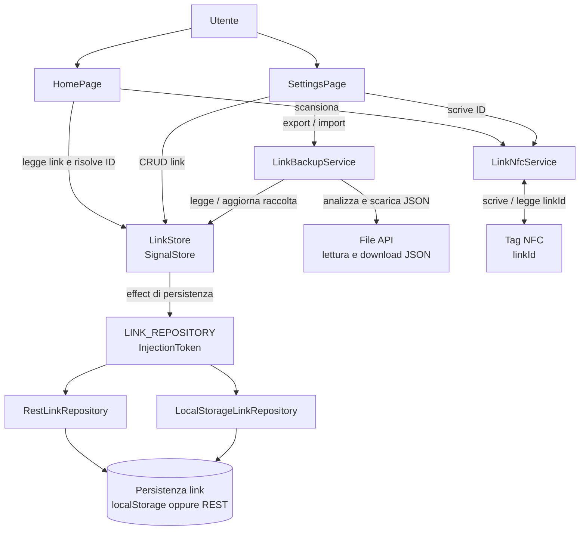

# Backup, esportazione e importazione

## Stato

La funzionalità è implementata. Questo documento descrive il formato, le scelte confermate e le dipendenze operative.

## Formato del backup

Il backup JSON è versionato e include gli identificativi stabili dei link. Le immagini e le associazioni NFC non vengono esportate:

```json
{
  "format": "linkboard-backup",
  "version": 1,
  "exportedAt": "2026-11-02T00:00:00.000Z",
  "links": [
    {
      "id": "uuid-stabile",
      "name": "Servizio",
      "url": "https://example.com/status"
    }
  ]
}
```

Il servizio rifiuta JSON malformato, formati/versioni non supportati, date non valide, ID vuoti o duplicati, nomi vuoti, URL diversi da HTTP(S) e file oltre 1 MB. I campi aggiuntivi, incluse eventuali immagini, non vengono importati.

## Importazione

La pagina Configurazione mostra il numero di link nel file e richiede conferma esplicita, con modalità:

- **Unisci:** aggiunge i link nuovi e aggiorna quelli che hanno lo stesso ID; conserva l'immagine locale dei link già presenti.
- **Sostituisci:** rimpiazza tutta la raccolta; i link importati non hanno immagini e le immagini della raccolta sostituita vengono rimosse.

Le immagini restano specifiche di ciascun dispositivo e possono essere scelte localmente dopo l'importazione. L'importazione passa da `LinkBackupService` e `LinkStore`, quindi usa il `LINK_REPOSITORY` configurato (localStorage o REST) e attende l'esito della persistenza. In caso di errore di salvataggio, lo store ripristina lo stato precedente e la UI mostra l'errore.

## Identificativi e NFC

- I nuovi link ricevono un ID generato da `crypto.randomUUID()`; se non disponibile, la creazione fallisce esplicitamente.
- Le modifiche a un link ne mantengono l'ID. Export/import conserva gli ID affinché i tag scritti continuino a risolverli.
- Ogni tag contiene l'ID del link, codificato UTF-8 nel record MIME `application/vnd.linkboard.tag`; non contiene URL o una chiave di associazione locale.
- È consentito associare più tag allo stesso link. In una scansione, le letture duplicate dello stesso ID vengono deduplicate; sessioni di scansione diverse risolvono indipendentemente lo stesso ID.
- L'app non enumera né revoca singoli tag. Riscrivere il tag lo riassegna; eliminare il link fa sì che i tag con quell'ID non risolvano un endpoint.
- La prima implementazione non include fallback legacy: non erano ancora stati programmati tag con il formato precedente. Prima di evolvere il formato NFC, sarà necessario definire una strategia di compatibilità e migrazione.

## Passaggio tra dispositivi o provider

Esportare dal dispositivo/repository sorgente e importare con il repository di destinazione selezionato. Cambiare da localStorage a REST non trasferisce automaticamente i dati. Perché un tag già scritto funzioni sul nuovo dispositivo, la raccolta caricata deve contenere il link con lo stesso ID. Il backup può contenere URL privati: va trattato come un file personale.

## Diagramma dei consumer e delle dipendenze



## Verifiche

I test unitari coprono schema e validazione del backup, assenza delle immagini in export, merge/replace, rollback se la persistenza fallisce, scrittura NFC diretta, più tag sullo stesso ID e anteprima/conferma UI. Build, lint e test vanno eseguiti durante la convalida delle modifiche; i test E2E richiedono le dipendenze browser di sistema.
